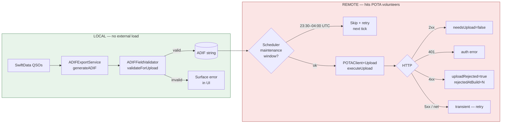
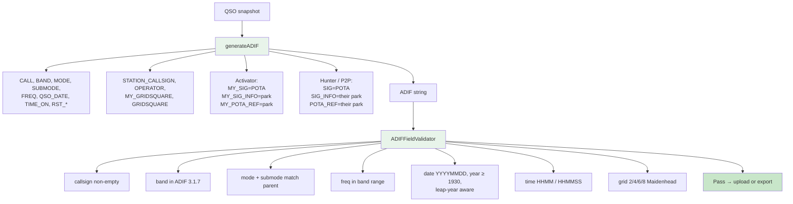
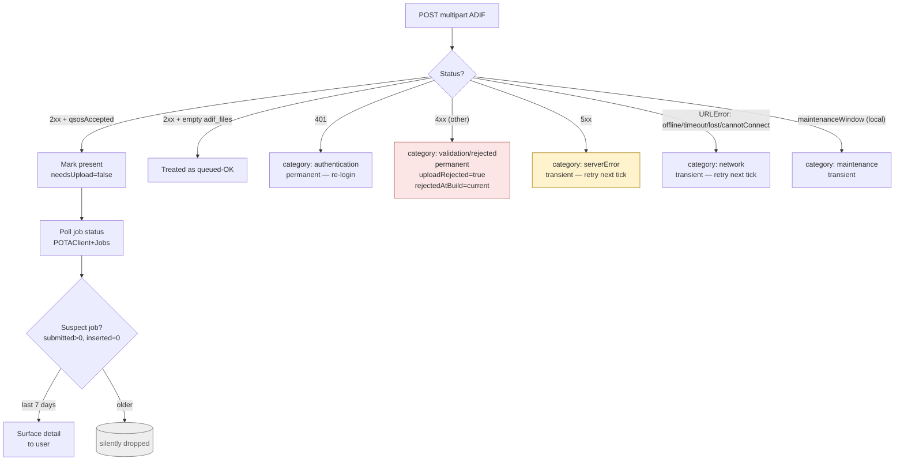
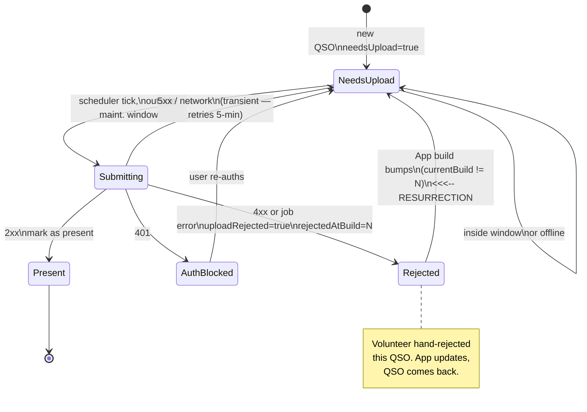
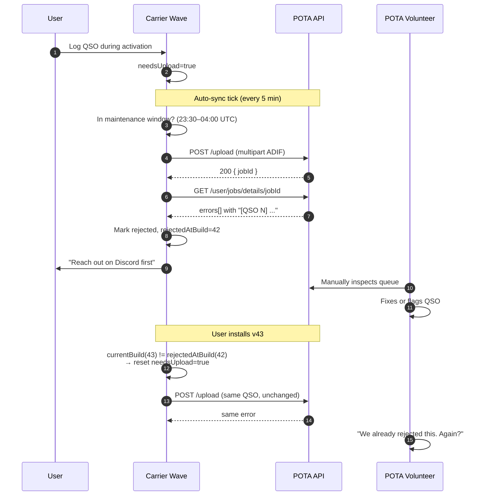
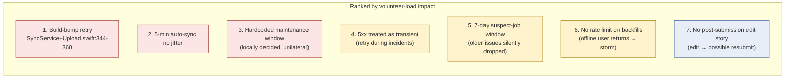
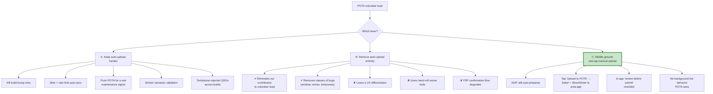

# POTA Uploads — Volunteer Load Infographic

**Date:** 2026-04-22
**Audience:** Carrier Wave eng + product
**Context:** POTA's volunteer log-wranglers are unhappy with us. Goal of this
doc: show what we do today, separate **ADIF generation** from **upload**, and
decide what (if anything) to change. Upload is the contentious piece; ADIF is
not.

---

## TL;DR

- **ADIF generation is fine.** It's local, on-demand, validated against ADIF
  3.1.7, and users can share/save it without ever touching POTA.
- **Automatic upload is the problem.** Five behaviors imposed on POTA
  volunteers without their consent: build-bump auto-retries, 5-min auto-sync
  thundering herd, hardcoded maintenance window, transient-5xx retry storms,
  and rejected-QSO resurrection.
- **Recommendation:** keep ADIF generation, drop fully-automatic upload,
  replace with a one-tap "Upload to POTA" that shares the ADIF out to the
  POTA web form. See [§8](#8-decision-remove-uploads).

---

## 1. Pipeline at a glance

Two steps, one orchestrator. The first step is harmless. The second is the
one POTA sees.

**Key separation:** `ADIFExportSheet.swift` exposes Share / Save to Files /
Copy independently of `SyncService`. The file exists before anything hits the
network. Removing auto-upload does **not** remove ADIF.

---

## 2. Where each step lives

| Concern | File | Notes |
|---|---|---|
| ADIF build | `CarrierWave/Services/ADIFExportService.swift:86-430` | Main generator |
| ADIF build (legacy) | `CarrierWave/Services/POTAClient+ADIF.swift:7-148` | Used inside upload path |
| ADIF validate | `packages/CarrierWaveCore/.../ADIFFieldValidator.swift:170-216` | Pre-upload gate |
| Upload orchestration | `CarrierWave/Services/SyncService+Upload.swift:161-198` | Decides to send |
| Upload execute | `CarrierWave/Services/POTAClient+Upload.swift:285-340` | HTTP POST |
| Response parse | `CarrierWave/Services/POTAClient+Upload.swift:391-424` | Status → outcome |
| Maintenance gate | `CarrierWave/Services/POTAClient+Maintenance.swift:11-31` | Hardcoded UTC window |
| Auto-sync loop | `CarrierWave/Services/AutoSyncService.swift:36-127` | 5/15/30/60 min |
| Per-park upload | `CarrierWave/Services/SyncService+UploadPOTA.swift:8-62` | Loop + dedup |
| Pre-upload dedup | `CarrierWave/Services/SyncService+UploadPOTA.swift:22-34` | Against `potaRemoteQSOMap` |
| Error classify | `CarrierWave/Services/UploadErrorClassifier.swift:145-146` | Category + guidance |
| Job error parse | `CarrierWave/Services/POTAJobErrorParser.swift:24-59` | Regex per-QSO |
| Suspect jobs | `CarrierWave/Services/POTAClient+Jobs.swift:118-126` | Last 7 days only |
| Build-bump retry | `CarrierWave/Services/SyncService+Upload.swift:344-360` | Resurrects rejected |
| Telemetry | `CarrierWave/Services/ActivitiesClient+Telemetry.swift:11-59` | Opt-in, hashed |

---

## 3. ADIF generation — the quiet, good part

Nothing here should be controversial for POTA. The ADIF produced is
well-formed and carries the POTA-specific tags the service expects.

**Independent export paths** (none of these touch POTA):

- `ShareLink` → Mail / AirDrop / Messages / Slack (`ADIFExportSheet.swift:138-147`)
- `fileExporter` → iCloud / Files (`ADIFExportSheet.swift:92-107`)
- `UIPasteboard` → paste into any web form (`ADIFExportSheet.swift:149-165`)

There is no "Send to POTA" button in the export sheet by design. Users who
want to go through POTA's web form can already do so.

---

## 4. Upload — what POTA's volunteers actually see

### 4.1 Scheduler behavior

Maintenance window is **decided locally**, not by POTA. No API contract, no
server signal. If POTA's real maintenance slips, we're wrong.

```mermaid
gantt
    title Daily upload cadence from one device (UTC)
    dateFormat HH:mm
    axisFormat %H:%M

    section Auto-sync ticks (5-min)
    Uploading            :active, 00:00, 23:30
    Skipped (maintenance) :crit,   23:30, 23:59
    Skipped (maintenance) :crit,   00:00, 04:00
    Uploading            :active, 04:00, 23:59
```

- Window: **23:30–04:00 UTC** (4.5 h/day), hardcoded in
  `POTAClient+Maintenance.swift:11-31`.
- Ticks: **every 5, 15, 30, or 60 min**, user choice
  (`AutoSyncService.swift:36-127`). Default is on the aggressive end.
- **No jitter** between devices. All clients wake at `:00 :05 :10` → herd.

### 4.2 Response handling

### 4.3 Error classification surface

| Category | Example trigger | User guidance | Retry? |
|---|---|---|---|
| `authentication` | HTTP 401 | "POTA login expired. Sign in again." | No — needs user |
| `validation` | Invalid park ref | "Reach out on Carrier Wave Discord **before** contacting POTA." | No |
| `rejected` | POTA job error string | Same Discord-first guidance | No (until build bump — see §5) |
| `maintenance` | Local window check | "Will retry after." | Yes, next tick |
| `serverError` | HTTP 5xx | "POTA rejected the upload. Check log." | **Yes, next tick** |
| `networkOffline` | `URLError.notConnectedToInternet` | "Will retry on next sync." | Yes, next tick |
| `networkTimeout` | `URLError.timedOut` | "Will retry on next sync." | Yes, next tick |

---

## 5. QSO upload lifecycle — the problematic state machine

This is the diagram worth reading twice. The red arrow is the one POTA
volunteers are angry about.

The `Rejected → NeedsUpload` transition (build-bump reset) is the single
biggest volunteer-load contributor. It was added to recover from **our**
bugs and externalizes that cost to POTA.

---

## 6. Sequence view — a day in the life of one QSO

---

## 7. Volunteer-load pressure ranking

Top offenders in descending order of how much extra triage they create.

### Malformed submissions that bypass our validation

Our validator is **syntactic**, not semantic. These reach POTA anyway:

- Semantic duplicates (same QSO, slightly different time/freq)
- Wrong park reference (valid format, wrong park)
- Future-dated QSOs (no upper bound check)
- Local-time-as-UTC timezone slips
- Bogus callsigns that pass regex (test/SWL/unsupported portables)
- P2P claims where the other side never activated
- Re-submissions of QSOs the user edited after acceptance

---

## 8. Decision — remove uploads?

### Recommendation

**Ship (C).** Concretely:

1. Keep `ADIFExportService` and `ADIFFieldValidator` untouched.
2. Delete the `SyncService+Upload` POTA path **or** gate it behind an
   explicit per-sync user tap ("Upload now"). Remove from `AutoSyncService`.
3. Add an "Upload to POTA" affordance in the activation detail view that
   opens POTA's upload page and attaches the freshly-generated ADIF via the
   system share sheet.
4. Add a pre-submit review screen: QSO count, date range, park ref,
   duplicates-with-existing-remote-log warning, anything `PendingUploadAnalyzer`
   flags. User must tap "Submit" on each activation.
5. Remove the build-bump retry (`SyncService+Upload.swift:344-360`)
   regardless of which path we take. It's defensible for QRZ/LoTW; it is not
   defensible for POTA.
6. If we keep *any* automatic path, add jitter and a per-client cap (e.g.
   ≤ 1 upload / 10 min / user) and treat 5xx as back-off-exponentially, not
   retry-on-next-tick.

### What we keep by doing this

- Full offline logging
- ADIF correctness
- Share / AirDrop / Files export
- QRZ, LoTW, eQSL, Club Log automatic upload (they have different
  volunteer/infra dynamics)
- P2P tagging inside the ADIF (the *data* is still right; only the *delivery
  mechanism* changes)

### What we lose

- "It just appears on POTA" magic for first-time users
- Auto-reconciliation against `potaRemoteQSOMap` stops being a background
  behavior and becomes a user-triggered one

---

## 9. Open questions for the team

- Does manual "force sync" currently bypass the maintenance gate at
  `SyncService+Upload.swift:190`? If yes, users submit into maintenance; if
  no, users are confused. Either answer is bad — clarify UI copy.
- What's the plan for QSOs **edited after successful submit**? Today's code
  does not appear to generate a corrective record; confirm this is
  intentional.
- Telemetry hash (`ActivitiesClient+Telemetry.swift:77`) — confirm callsigns
  cannot be recovered from the SHA256 prefix by a dictionary attack over
  known-valid calls.
- Is there a kill-switch to remotely pause POTA uploads from a bad build?
  If not, that's a prerequisite before we can defend *any* automatic path.
- Has anyone on our side actually talked to POTA's log team about a
  machine-readable maintenance window or a rate-limit contract? If not, this
  doc is evidence we should.

---

## 10. Appendix — cross-references

- Research traces that produced this doc:
  - Upload scheduling: `POTAClient+Maintenance.swift`, `SyncService+Upload.swift`, `AutoSyncService.swift`
  - Error handling: `POTAClient+Upload.swift`, `POTAJobErrorParser.swift`, `POTAClient+Jobs.swift`, `UploadErrorClassifier.swift`
  - ADIF generation: `ADIFExportService.swift`, `POTAClient+ADIF.swift`, `ADIFFieldValidator.swift`
- Related docs: `docs/investigations/pota-uploads.md`, `docs/investigations/comment-park-reference.md`
- Server API: `server/docs/api.md`
