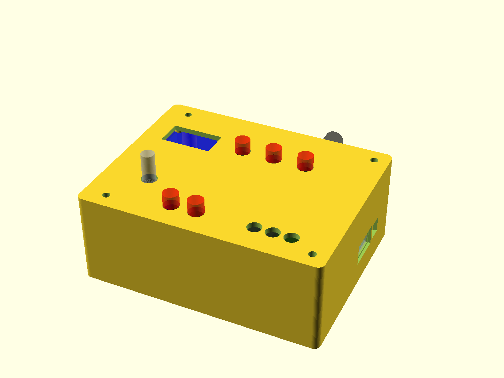

# CW Bridge rev 2.1 enclosure

Box for `hardware/bridge/cw_bridge.kicad_pcb` (rev 2.1, 100 × 80 mm, M3
holes 4 mm in from each corner). The PCB sits on four posts in the 3D-printed
**base** with the LiPo cell flat underneath it. The **top** carries the whole
front panel (OLED, KY-040 encoder, five 7 mm buttons, three LED holders) and comes
in two flavours, chosen by `lid_style` in the .scad:

- `"acrylic"` (default) — a laser-cut, engraved 3 mm acrylic sheet from
  `make_lid_panel.py` (`lid_panel.xcs` for xTool Studio, `lid_panel.svg` for
  anything else) plus four printed spacer tubes (`spacers.stl`). M3 screws go
  in from the top.
- `"printed"` — a 3D-printed lid with the spacer tubes and two KY-040 screw
  columns built in (`lid.stl`). M3 screws also go in from the top, so the one
  `base.stl` fits either top.



## Render / export

OpenSCAD is `openscad@snapshot` from Homebrew (the stable `openscad` cask is
disabled); binary at `/opt/homebrew/bin/openscad`.

```
openscad -o base.stl    -D 'part="base"'    cw_bridge_enclosure.scad
openscad -o spacers.stl -D 'part="spacers"' cw_bridge_enclosure.scad
openscad -o lid.stl     -D 'part="lid"' -D 'lid_style="printed"' cw_bridge_enclosure.scad
python3 make_lid_panel.py            # lid_panel.svg + lid_panel.xcs (needs fontTools)
python3 make_lid_panel.py --mirror --out lid_panel_mirror   # cut/engrave from the back face
```

or set `part` at the top of the file, F6, export. `part = "assembly"` draws
the base, the acrylic (or printed) top and ghosts of the PCB, connectors,
battery and panel parts for a fit check — do not print it. The committed
STLs match the defaults below. `base.stl` has blind M3 pilots in the posts
and works with both tops (since 2026-10-18; before that the printed lid
screwed in from below and needed its own base).

The panel layout comes from the hand-edited `lid_panel.xs` (xTool Studio,
saved 2026-10-14 08:35). That file is the master for the acrylic sheet and
is not regenerated; `lid_panel.xcs`/`.svg` from `make_lid_panel.py` predate
that edit.

## Acrylic top (xTool Studio)

`make_lid_panel.py` reads the outline, screw holes and every panel cutout
from the .scad (so the two cannot drift), adds engraved labels in Routed
Gothic (`fonts/`, OFL) and writes:

| File | What |
|---|---|
| `lid_panel.xcs` | xTool Studio project: one element per shape, cuts on a red layer with vector-cut processing, labels on a black layer as fill-engraving, device set to the P2S, 3 mm sheet. Open it directly (`File → Open`). |
| `lid_panel.svg` | the same drawing, mm 1:1, red = cut / black = engrave, for xTool's SVG import or any other laser software |
| `lid_panel_mirror.*` | mirrored copy for engraving the **underside** (cut and engrave from the back with the protective film left on the show face; the labels read correctly through the sheet) |

Panel is 109.6 × 85.6 mm, 3 mm cast acrylic. The .xcs carries starting
power/speed values (cut 100 % / 12 mm/s, fill-engrave 25 % / 300 mm/s);
replace them with the P2S material preset for your sheet before running.
If xTool Studio refuses the .xcs (the format is reverse-engineered, not
published), import `lid_panel.svg` instead — red strokes → cut, black fills →
engrave.

Labels: `CW BRIDGE` title, `BTN1`–`BTN3` under the front row, `RESET`/`BOOT`
above the small rear-left pair, `PWR`/`BT`/`USB` beside the LEDs, plus the port
labels along the edges — `COMPUTER/POWER` over the USB-C, `RADIO` and
`RUN - FLASH` (rotated) beside the USB-A and the SW3 wall window, `AUDIO IN` /
`AUDIO OUT` beside the jacks. Edit `TITLE`, `BTN_LABELS`, `LED_LABELS` and
`FREE_LABELS` in the script. The layout was arranged by hand in xTool Studio
(`lid_panel.xs`, 2026-10-14) and folded back into the .scad / script, so the
generated `lid_panel.xcs` reproduces it to < 0.1 mm.

## Outer size (defaults)

**109.6 × 85.6 × 42.6 mm** (L × W × H) with the 3 mm acrylic top (42 mm with
the printed lid). The left wall is 6.4 mm thick (2.4 mm wall + 4 mm
battery-lead gutter); the other walls are 2.4 mm.

## Coordinates

`X = KiCad x − 50` (left → right), `Y = 130 − KiCad y` (front → rear), Z up
from the base underside. `board_z` (12.6 mm) is the PCB top face.

## Board-side openings (from the PCB + datasheets / KiCad STEP models)

| Wall | Part | Opening | Notes |
|---|---|---|---|
| rear | J9 USB-C (KiCad x 133) | 13.5 × 7.5, centred 1.65 mm above the PCB | single plug-size opening; the receptacle is only 0.17 mm proud of the PCB edge so the plug has to reach through the wall |
| rear | SW2 power switch (x 76) | 8 × 3.5 slot at PCB level | PCM12 actuator sits ~0.5 mm inside the board edge; flick it with a fingernail/toothpick |
| rear | SMA bulkhead | Ø6.6 at PCB + 14 mm, X 66 | for the U.FL → SMA-female bulkhead pigtail |
| right | J1 USB-A (y 80.3) | 14.2 × 8.0 through the wall, 16.5 × 9.5 plug pocket from outside, 1.2 mm step | shell is 1.2 mm proud of the PCB edge and enters the inner opening |
| left | J8 AUDIO IN (y 72), J7 AUDIO OUT (y 98) | Ø6.8 through, Ø11 plug bore from outside, 1 mm step | SJ1-3515N: axis 3.0 mm above the PCB, Ø6 bushing protrudes 1.3 mm past the edge |
| right | SW3 RUN/FLASH (147.3, 67) | 7 × 7.5 window from 0.5 mm below to 7 mm above the PCB top, centred Y 63 | the switch sits ~1 mm inside the board edge so the board goes in past it; push the vertical actuator (~5.5 mm tall) along Y with a pick/fingernail from outside (RUN = toward the front, FLASH = toward the rear). Above the window the wall is thinned from the inside to a 1 mm skin (`sw3_skin`) up to the rim so the actuator clears it during install. `sw3_notch_w`/`sw3_notch_h` set the size; width kept narrow to leave a ~1.5 mm web beside the USB-A plug pocket. The old 4 × 11 lid slot is off (`sw3_slot_on = false`) |

## Lid layout (defaults, model coordinates)

| Part | Position | Hole | Under it on the PCB |
|---|---|---|---|
| OLED 0.96" | centre (15.15, 56.14), pins toward the rear | 23.8 × 13.0 window offset 2.1 mm toward the pin edge, 4 × Ø4 bosses with Ø1.6 M2 pilots at 23.5 × 23.8 | AUDIO IN jack (6 mm) and J10; module edge 0.3 mm inside the lid lip |
| KY-040 encoder | shaft (14.06, 22.07), mounting holes toward +X (`enc_rot = 0`), header toward the rear | Ø7.2, plus two Ø5 screw columns 6.5 mm long at (22.06, 15.32) and (22.06, 29.17) | J15 and AUDIO OUT; module PCB bottom ~19 mm above the board |
| BTN1 BTN2 BTN3 | (40.74, 58.25) (55.74, 58.25) (70.74, 58.25) | Ø7.2 | WROOM (3.2 mm); BTN3 is 0.8 mm beside the J11 debug plug |
| RESET BOOT | (31.73, 9.32) (43.21, 9.32) | Ø7.2 | **directly above the J4/J5/J6 (BTN1–BTN3) headers** — see "Verify" |
| LEDs PWR BT USB | (68.84, 10.02) (76.84, 10.02) (84.84, 10.02) | Ø6.4 | J14 and J12 (holders end ~18 mm above the board) |

Buttons are GTIWUNG / PBS-110 style 7 mm pre-wired momentaries (1/4" thread,
Ø7 hole, ~27 mm long overall). Allow ~9.5 mm for the nut beside each hole.

The KY-040 screws to the columns from below with 2 × M2.5 × 8 self-tappers
through its Ø3 holes (`enc_col_pilot` 2.1; 1.6 for M2). Column length
`enc_stand` (6.5) is the EC11 body height, so the bushing shoulder seats
against the lid underside and no bushing nut is needed. Hole geometry comes
from a KY-040 panel footprint (3 mm holes, 13.85 mm pitch, 8 mm beside the
shaft); sellers quote 13.75 mm. Change `enc_rot` (0/90/180/270) if your
module's holes sit on another side. The columns are notched where they
would touch the encoder body.

Everything is a variable at the top of the file; move things by editing
`btn_pos` / `btn_ds`, `led_pos`, `oled_c`, `enc_c`, then re-run `make_lid_panel.py`.

Height budget: `top_clear` (27 mm, was 22 until 2026-10-14) = lid underside to PCB top. The tallest
lid parts are the 7 mm buttons, assumed to hang 19 mm (`btn_depth`, lugs and
heatshrink included); the tallest board parts are the mated JST PH plugs
(~10 mm) and USB-A (7 mm). A button bottom therefore sits ~8 mm above the
board, 2 mm lower than a plug top.

## Battery

EEMB 1100 mAh pouch (603449-class, 6 × 34 × 49 mm assumed — **measure**) lies
on the floor under the board inside four 2.5 mm corner stops; `standoff`
(8 mm) leaves 2 mm over the cell for the through-hole pin stubs. Wrap the cell
in Kapton/foam tape — PH header pins protrude ~3.4 mm below the PCB. Its lead
comes up the gutter at the rear-left corner (X −4.4…−0.4, Y 65…79) and plugs
into J10 ~10 mm away. Check polarity before plugging in (see
`production/digikey_list.md`).

## Fasteners

Acrylic top (default):

- **4 × M3 × 40 from the top.** Each screw goes down through the Ø3.4 hole in
  the sheet, a printed spacer tube (Ø7 × 27, `spacers.stl`), the PCB corner
  hole and into a blind Ø2.5 pilot in the floor post (self-tapping, 9 mm
  deep — the screw reaches ~8.4 mm). Set `thread_d` 4.0 for M3 heat-set inserts in the posts and use
  M3 × 35. The screws clamp the sheet, the tubes and the PCB in one stack.
- OLED: 4 × M2 × 8 through the Ø2.2 holes in the sheet, 2 mm nylon spacers
  (or washers) between sheet and module, nuts behind the module.

Printed lid (`lid_style = "printed"`):

- **4 × M3 × 35 from the top.** Each screw goes through the lid plate and its
  built-in tube (31 mm of lid, tube and PCB), then 4 mm into the post's
  blind pilot. M3 × 40 bottoms out exactly at the 9 mm pilot depth; add a
  washer if that is what you have.
- OLED: 4 × M2 × 5 into the lid bosses (`oled_pilot` 1.6 self-tap).
- KY-040: 2 × M2.5 × 8 from below into the screw columns.

Both:
- Buttons: their own nuts. LEDs: the bezel/clip. On the acrylic top the
  encoder uses its M7 bushing nut (no columns).
- SMA bulkhead: its own nut on the outside of the rear wall.

## Wiring notes

- Solder the panel leads directly to the KY-040 and OLED header pins (bend
  the pins flat). Dupont housings on the KY-040 do not fit under the lid, and
  Dupont housings on the OLED hang 18 mm and get within 1 mm of the WROOM.
- Encoder/OLED/button/LED leads terminate in JST PH housings on J15/J3/
  J4–J6/J13/J14/J12 (top-entry, wires exit upward then bend).

## ⚠️ Verify before printing

1. **OLED module**: PCB 27.5 × 27.8, Ø2 holes at 23.5 × 23.8, visible area
   23.74 × 12.86 with its centre 11.8 mm from the pin edge — all from the
   vendor drawing (2026-10-13). Still unmeasured: `oled_boss_h` (2.0 = glass
   stack height above the module PCB).
2. **LED holder hole** `led_d`: 6.4 for clip-style holders, ~8.0 for
   bezel-with-nut holders.
3. **Battery** `bat_l/bat_w/bat_t` against the actual cell.
4. **USB-A plug** — `usba_outer` 16.5 × 9.5 passes a standard overmold;
   widen for chunky cables. Same for `usbc_port` and `trs_plug_d` (11 mm).
5. **KY-040 columns**: hold a module against the printed lid's two columns
   before tightening. Check the hole pitch (`enc_holes`, 13.85), the side the
   holes are on (`enc_rot`) and the PCB-top-to-bushing-shoulder height
   (`enc_stand`, 6.5).
6. **RESET / BOOT over the BTN headers**: with `btn_depth` 19 the switch
   bodies end ~2 mm below the top of mated plugs in J4, J5 and J6. Measure a
   switch from the underside of the panel to the end of its heatshrink. If it
   is over 17 mm, move the two holes rearward until their centres are at
   Y ≥ 13 (`btn_pos`) or use right-angle leads in J4–J6.
7. **LED holders** are 8 mm apart, centre to centre. Bezel flanges wider than
   8 mm will touch.

## Print notes

- Base prints floor-down, no supports (the wall openings are short bridges).
- Spacers print standing up, 4 off.
- Printed lid prints top-face-down (`part = "lid"` is already flipped); the
  tubes, lip, OLED bosses and encoder columns stand up — no supports.
- 0.2 mm layers, 3 perimeters, 20 % infill. PETG if it lives in a hot car.
- The old Heltec proof-of-concept box is `firmware/docs/cw-bridge-box.scad`;
  the breadboard build's case is `hardware/case/`. Neither fits this PCB.
